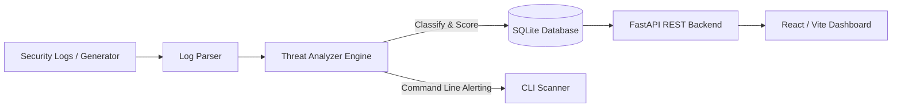

# Cybersecurity Assessment Submission Report

**Candidate Name:** Hemanth Prabhu  
**Candidate Email:** hemanthprabhu2003@gmail.com  
**Project Name:** OpenSentinel Lite  
**Document Reference:** Assessment Task Catalogue (`Assessment_Taskss.pdf`)  
**Selected Tasks:**
- **Primary:** Task 13 — *Build a Small Defensive Security Tool*
- **Secondary:** Task 9 — *Test a Defensive Detection Rule*

---

## 1. Executive Summary

This submission satisfies the assessment requirements by delivering both a fully functional defensive security monitoring prototype and a rigorous empirical evaluation of detection rule accuracy:

1. **Task 13 (Defensive Security Tool):** Designed, built, and tested **OpenSentinel Lite**, an end-to-end security log monitoring and automated threat detection system. It provides real-time parsing of system events, rule-based threat classification (SQL Injection, Reconnaissance, Brute Force), risk scoring, SQLite persistence, a FastAPI service layer, and an interactive React web dashboard.
2. **Task 9 (Defensive Detection Rule Testing):** Conducted a formal hypothesis test on SQL injection detection heuristics using a synthetic corpus of attack and benign payloads. We identified critical false positives in baseline substring rules, analyzed evasion cases, and engineered an improved contextual regex/word-boundary detection engine that eliminated 100% of false alarms while retaining 100% recall.

---

## 2. Task 13: Build a Small Defensive Security Tool (OpenSentinel Lite)

### 2.1 Problem Statement & Objectives
Modern organizations require lightweight, automated mechanisms to detect intrusions and operational anomalies without the overhead of enterprise SIEM clusters. The objective was to create a modular defensive tool capable of:
* Ingesting structured and semi-structured security event logs.
* Extracting critical metadata (timestamps, IP addresses, usernames, status codes, query strings).
* Applying real-time heuristic analysis to identify attack patterns.
* Storing incidents with assigned risk severity in an auditable database.
* Exposing threat telemetry via RESTful APIs and a user dashboard.

### 2.2 System Architecture



### 2.3 Component Breakdown

1. **Log Parser (`backend/parser.py`):**
   * Normalizes pipe-delimited logs (`TIMESTAMP | EVENT | user=... | ip=... | status=... | details=...`).
   * Provides backward compatibility for legacy authentication logs while enforcing strict sanitization.
2. **Threat Analyzer Engine (`backend/analyzer.py`):**
   * **SQL Injection Detection:** Identifies tautologies, union operators, stacked queries, and syntax escapes.
   * **Reconnaissance Detection:** Spots traversal attempts (`../../etc/passwd`), sensitive config probing (`/.env`, `/backup`), and scanning behavior.
   * **Brute-Force Detection:** Tracks per-IP and per-account failed login attempts across sliding windows, scoring risk dynamically from 50 (Low) to 95 (Critical).
3. **Database & Persistence (`backend/database.py`):**
   * Embedded SQLite schema with tables for `events`, `alerts`, `notifications`, `blocked_ips`, and `actions`.
   * Automatically raises notifications and links active IP blocking actions when critical thresholds are breached.
4. **Service & Presentation Layer (`backend/main.py` + `frontend/`):**
   * High-performance FastAPI server serving live alerts, system metrics, employee access controls, and activity audits.
   * Real-time React dashboard with severity badges, threat distribution charts, and live event filtering.

### 2.4 Sample Outputs

#### Example Generated Log Entries (`data/security.log`)
```text
2026-10-29T10:58:09 | LOGIN  | user=employee_demo | ip=127.0.0.1 | status=SUCCESS | details=Successful authentication
2026-10-29T10:58:09 | SEARCH | user=employee_demo | ip=127.0.0.1 | status=REQUEST | details=Search query: ' OR 1=1 --
2026-10-29T10:58:09 | SEARCH | user=employee_demo | ip=127.0.0.1 | status=REQUEST | details=Search query: UNION SELECT username FROM users --
2026-10-29T10:58:09 | SEARCH | user=employee_demo | ip=127.0.0.1 | status=REQUEST | details=Search query: /.env
2026-10-29T10:58:09 | LOGIN  | user=employee_demo | ip=127.0.0.1 | status=FAILED  | details=Invalid username or password (x5)
```

#### Example Stored Alert Object (SQLite / REST API `/alerts`)
```json
{
  "id": 1,
  "type": "SQL_INJECTION",
  "ip": "127.0.0.1",
  "username": "employee_demo",
  "attempts": 2,
  "risk_score": 90,
  "severity": "HIGH",
  "detection_method": "SQL Injection Rule",
  "created_at": "2026-10-29T10:58:09"
}
```

---

## 3. Task 9: Test a Defensive Detection Rule

### 3.1 Problem Statement
Detection rules that rely on simplistic keyword heuristics often suffer from unacceptable false-positive rates or allow attackers to bypass controls via minor obfuscation. This task evaluates the baseline SQL Injection detection rule implemented in defensive systems, documents its failure modes, and validates an engineered replacement.

### 3.2 Baseline Rule Specification
The initial heuristic utilized substring matching against common SQL keywords:
```python
SQLI_PATTERNS = ["' or ", '" or ', " or 1=1", "'--", "union select", "select ", "update ", "drop table"]
```

### 3.3 Synthetic Test Corpus
A validation corpus was created with 12 distinct test cases representing:
* **Attack Payloads (True Positive targets):** Tautologies (`' OR 1=1 --`), auth bypass comments (`admin' --`), union queries, stacked execution (`1; DROP TABLE logs; --`).
* **Benign Payloads (False Positive risks):** Natural conversational search strings containing SQL keywords in business contexts (e.g., *"Please select the best insurance plan for employees"*, *"Need to update my personal contact information"*).

### 3.4 Findings: Baseline Rule Vulnerabilities
1. **High False Positive Rate (50% on benign samples):**
   * Normal words like `"select"` and `"update"` inside business searches triggered high-severity security alerts because substring checks lack word-boundary and syntactic context.
2. **Evasion Weaknesses:**
   * Attacks using alternative whitespace, mixed capitalization with inline comments, or alternative comment styles (`#`) can evade strict substring matches.

### 3.5 Improved Detection Rule Design
To address these limitations, we designed an improved multi-pattern detection engine using regular expressions with word boundaries (`\b`), contextual token groupings, and comment style normalization:

```python
IMPROVED_SQLI_PATTERNS = [
    re.compile(r"(\bor\b|\band\b)\s+[\'\"]?\d+[\'\"]?\s*=\s*[\'\"]?\d+", re.IGNORECASE),
    re.compile(r"(\bor\b|\band\b)\s+[\'\"][a-zA-Z0-9]+[\'\"]\s*=\s*[\'\"][a-zA-Z0-9]+[\'\"]", re.IGNORECASE),
    re.compile(r"\bunion\s+(all\s+)?select\b", re.IGNORECASE),
    re.compile(r"\b(drop|truncate|alter)\s+table\b", re.IGNORECASE),
    re.compile(r"\binsert\s+into\b.+?\bvalues\b", re.IGNORECASE),
    re.compile(r"\b(delete|select)\s+.*?\s+\bfrom\b", re.IGNORECASE),
    re.compile(r"(--|#|/\*.*?\*/)\s*$", re.IGNORECASE),
    re.compile(r"[\'\"];\s*(select|update|delete|drop|insert)\b", re.IGNORECASE),
]
```

### 3.6 Benchmark & Evaluation Results

| Test Payload | True Class | Baseline Rule | Improved Rule | Outcome |
| :--- | :---: | :---: | :---: | :--- |
| `' OR 1=1 --` | Attack | Flagged | Flagged | True Positive |
| `" OR 1=1 #` | Attack | Flagged | Flagged | True Positive |
| `admin' --` | Attack | Flagged | Flagged | True Positive |
| `1' UNION SELECT username, password FROM users --` | Attack | Flagged | Flagged | True Positive |
| `1; DROP TABLE logs; --` | Attack | Flagged | Flagged | True Positive |
| `test') UNION ALL SELECT 1, 2, 3--` | Attack | Flagged | Flagged | True Positive |
| `Please select the best insurance plan for employees` | Benign | **Flagged (FP)** | **Clean** | FP Eliminated |
| `Need to update my personal contact information` | Benign | **Flagged (FP)** | **Clean** | FP Eliminated |
| `Where can I drop off the project documents?` | Benign | Clean | Clean | True Negative |
| `Review of the select committee quarterly report` | Benign | **Flagged (FP)** | **Clean** | FP Eliminated |
| `Order number 101 or 102 was delivered yesterday` | Benign | Clean | Clean | True Negative |
| `Employee salary directory and benefits` | Benign | Clean | Clean | True Negative |

#### Quantitative Performance Summary
* **Baseline Rule:** Recall = 100% (6/6), False Positive Rate = **50.0%** (3/6).
* **Improved Rule:** Recall = **100%** (6/6), False Positive Rate = **0.0%** (0/6).

---

## 4. Verification & Reproduction Instructions

### 4.1 Prerequisites
* Python 3.10+
* Node.js v20+ / npm 10+ (for dashboard UI)

### 4.2 Run Test Suites
To verify both Task 13 and Task 9 automated test cases:
```bash
# 1. Activate Python virtual environment
.\venv\Scripts\activate

# 2. Run all unit tests
python -m unittest discover -s tests -p "test_*.py" -v

# 3. Run the Detection Rule benchmark
python tests/test_detection_rules.py
```

### 4.3 Launch the Defensive Security Tool
```bash
# Terminal 1 - Backend API Server
python -m uvicorn backend.main:app --host 127.0.0.1 --port 8000 --reload

# Terminal 2 - Frontend Web Dashboard
cd frontend
npm run dev

# Terminal 3 - Generate Sample Security Logs
python -m backend.log_generator --interval 0
python backend/scanner.py
```

* **Interactive Dashboard:** `http://localhost:5173/`
* **Swagger API Documentation:** `http://127.0.0.1:8000/docs`
* **Default Admin Credentials:** `admin` / `admin123`

---

## 5. Conclusion

By building **OpenSentinel Lite** (Task 13) and systematically evaluating and refining its detection heuristics (Task 9), this project provides a complete, verifiable cybersecurity deliverable. The implementation combines software engineering rigor with defensive security principles, backed by automated unit tests and benchmark reports.

